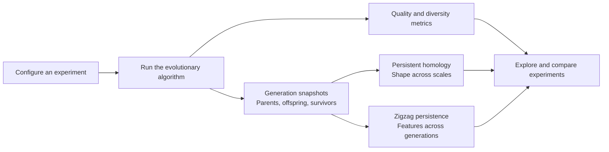

# ESPHEA

**E**xploratory **S**tudy of **P**ersistent **H**omology in **E**volutionary **A**lgorithms

ESPHEA is a research platform for studying the topology of evolving populations. It records
parents, offspring and survivors, then computes persistent homology and zigzag persistence from
those snapshots so that variation and selection can be studied separately.

> ⚠️ **Status:** early-stage research. Hypotheses, methods and repository layout are subject to change.

- [Getting started](#getting-started)
- [Platform capabilities](#platform-capabilities)
- [Motivation](#motivation)
- [Research questions](#research-questions)
- [Broader research scope](#broader-research-scope)
- [Development](#development)
- [Repository layout](#repository-layout)
- [Tooling](#tooling)
- [Introductory references](#introductory-references)
- [License](#license)
- [How to cite](#how-to-cite)

## Getting started

Requirement: Docker with the Compose plugin. The `make` shortcuts also require Make; no Python
or Node.js installation is needed on the host.

```bash
docker compose up -d --build
# Equivalent shortcut: make up
```

| Resource                      | Location                                                 |
| ----------------------------- | -------------------------------------------------------- |
| Web interface                 | <http://localhost:8090>                                  |
| Interactive API documentation | <http://localhost:8000/api/docs>                         |
| Generation snapshots          | `data/runs/<run-id>/attempt-<n>/part-*.parquet`          |
| Offline analysis results      | `data/runs/<run-id>/analyses/<analysis-id>/attempt-<n>/` |

Create an experiment in the web interface, choose an algorithm and problem, and follow its runs
live. After a run finishes, replay its generations and queue analyses in the _Topology_ tab.
For zigzag persistence, keep snapshots enabled with **every generation stored** (`every: 1`);
it also requires individual identities, available in snapshot schema 2.



Ports can be changed with `ESPHEA_UI_PORT` and `ESPHEA_API_PORT`. Set `ESPHEA_WORKERS`
(default `2`) or use `docker compose up -d --scale worker=4` to change worker concurrency.
These workers share the queue for runs and analyses.

Use `docker compose logs -f api worker` to follow execution and `docker compose down` to stop
the platform. PostgreSQL data stays in the `pgdata` Docker volume; snapshots and analysis
results stay in the host's `./data` directory.

## Platform capabilities

The implemented platform supports **NSGA-II**, **NSGA-III** and a **generational SMS-EMOA** on
**DTLZ2**, **DTLZ7**, **ZDT1**, **ZDT3**, **ZDT4** and **DTLZ2-H**. DTLZ7 and ZDT3 have
disconnected fronts, ZDT4 is multimodal, and DTLZ2-H provides a three-objective front with a
known hole for studying H₁.

| Capability             | What is available                                                                                                                                                                                                      |
| ---------------------- | ---------------------------------------------------------------------------------------------------------------------------------------------------------------------------------------------------------------------- |
| Instrumented evolution | A shared generational loop exposes parents, matings, offspring lineage, mutation flags and survivors. Numerical kernels come from pymoo; slow tests compare NSGA-II/III statistically with its native implementations. |
| Quality and diversity  | IGD, IGD+, GD, survivor and offspring hypervolume, spacing, generalised spread, mean objective-space distance and decision-space inertia.                                                                              |
| Reusable snapshots     | Compressed Parquet stores individuals and their identities, with configurable frequency, precision and decision-variable storage.                                                                                      |
| Live exploration       | Configuration validation, live progress, generation replay in 2D/3D/parallel coordinates and convergence comparisons.                                                                                                  |
| Persistent homology    | Offline Vietoris–Rips barcodes, Betti curves, persistence summaries, bottleneck/Wasserstein distances and the Hausdorff stability baseline.                                                                            |
| Zigzag persistence     | Features tracked across generations at fixed scales, births and deaths attributed to variation or selection, and representative niches/cycles when computational limits allow.                                         |
| Niche trackers         | Three H₀ tracking heuristics compared with zigzag barcodes and experiment rankings.                                                                                                                                    |
| Across-run comparison  | Median and interquartile range of indicators and topological series, grouped by analysis configuration.                                                                                                                |

Zigzag analyses support two middle complexes: `rips` uses all parents and offspring;
`union` uses the parents and survivors, leaving out offspring discarded immediately. Both use
Vietoris–Rips complexes, so they answer different questions about transient candidate features
and the features carried by successive populations.

See the [architecture guide](docs/architecture.md) for service and dependency diagrams, execution
and recovery, storage schemas, analysis details and extension points.

## Motivation

Evolutionary algorithms (EAs) operate on populations of candidate solutions that move through search spaces which are often high-dimensional, multimodal and poorly understood. Classical diversity measures (mean pairwise distance, entropy, genotypic variance) collapse the population into a single number and lose information about its **shape**: how many clusters exist, whether there are "holes" or cyclic structures, and how these structures appear and vanish over the generations.

**Persistent homology** (PH), a central tool of Topological Data Analysis (TDA), describes the shape of point clouds across multiple scales through topological invariants (connected components, loops, voids) and their persistence along a filtration. This repository investigates whether this multiscale description can provide a new and useful view of EA dynamics.

## Research questions

1. **Population characterization:** do persistence diagrams recover niche structure that classical
   diversity metrics miss, and tell configurations apart earlier?
   _Status:_ supported, mostly through H₀; over time the summaries are largely redundant with
   classical metrics.
2. **Early warning:** can front-free signals anticipate a failed run (truncated front, local front)?
   _Status:_ negative so far. With ideal–nadir scaling the diagrams are translation-invariant, so
   they do not see convergence.
3. **Fitness landscape analysis:** do sublevel filtrations reveal problem modality, and does the
   population topology follow which basins of attraction (local fronts, in multi-objective
   problems) are occupied?
   _Status:_ sublevel H₀ counts the local minima exactly; tracking of occupied basins is moderate.
4. **Adaptive control:** can topological descriptors drive operator and parameter control?
   _Status:_ deferred until question 2 yields an anticipatory signal.
5. **Front coverage indicator:** can the diagram distance to the reference front measure gaps and
   holes alongside IGD and hypervolume?
   _Status:_ supported for interior gaps and holes; it is blind to the front extent and is not
   Pareto-compliant.
6. **Variation vs. selection:** does zigzag persistence of P₀ → R₁ ← P₁ → …, attributing each niche
   birth and death to variation or selection, explain how problems, algorithms and operators shape
   niche dynamics, beyond simpler niche trackers?
   _Status:_ main line of the project; open points are the added value over simple proxies and
   choosing the scale without the true front.

## Broader research scope

The following scope includes directions beyond the implemented platform above:

- **Representation:** the population at each generation is treated as a point cloud in genotype and/or phenotype space (or in objective space).
- **Filtrations:** Vietoris–Rips and Alpha complexes, and sublevel-set filtrations of the fitness function.
- **Descriptors:** persistence diagrams, barcodes, persistent entropy, persistence landscapes and images, and _bottleneck_ / _Wasserstein_ distances between generations.
- **Algorithms:** Genetic Algorithms, Evolution Strategies (incl. CMA-ES), Differential Evolution and multi-objective EAs (e.g. NSGA-II).
- **Test problems:** continuous benchmark functions (e.g. the BBOB/COCO suite, Rastrigin, Schwefel), combinatorial problems and multi-objective problems (ZDT, DTLZ).
- **Evaluation:** comparison against classical diversity and performance metrics, with multiple independent runs and appropriate statistical tests.

## Development

Development checks run their tools in containers. Install the locked frontend dependencies
before running the combined checks:

```bash
make help               # list all shortcuts
make frontend-install   # install the locked frontend dependencies
make check              # backend (ruff, mypy, pytest) and frontend (eslint, tsc, vitest, build)
make backend-validate   # slow statistical comparison with pymoo's NSGA-II/NSGA-III
make openapi            # regenerate the frontend API types after changing the API
```

## Repository layout

| Path                                           | Contents                                                          |
| ---------------------------------------------- | ----------------------------------------------------------------- |
| [`backend/src/esphea/`](backend/src/esphea/)   | Domain model, algorithms, experiments, topology, API and workers. |
| [`backend/tests/`](backend/tests/)             | Unit, integration and statistical validation tests.               |
| [`backend/migrations/`](backend/migrations/)   | Alembic database migrations.                                      |
| [`frontend/`](frontend/)                       | React + TypeScript interface and generated API types.             |
| [`docs/architecture.md`](docs/architecture.md) | Architecture, data flow and extension guide.                      |
| `data/`                                        | Local experiment snapshots and analysis outputs (git-ignored).    |
| [`docker-compose.yml`](docker-compose.yml)     | Local services, volumes, ports and worker scaling.                |
| [`Makefile`](Makefile)                         | Container-based development commands.                             |

## Tooling

Backend: Python 3.13, NumPy, pymoo, moocore, PyArrow, FastAPI, SQLAlchemy, PostgreSQL,
Redis and RQ. Numerical kernels use [pymoo](https://pymoo.org/); IGD, IGD+ and hypervolume use
[moocore](https://multi-objective.github.io/moocore/python/), while GD uses a SciPy KD-tree.
Persistent homology uses [Ripser](https://ripser.scikit-tda.org/) for Vietoris–Rips diagrams,
[GUDHI](https://gudhi.inria.fr/) for diagram distances and
[Dionysus](https://mrzv.org/software/dionysus2/) for zigzag persistence.

Frontend: React, TypeScript, Vite, Mantine, TanStack Query and Plotly. Dependency versions are
locked in [`backend/uv.lock`](backend/uv.lock) and
[`frontend/package-lock.json`](frontend/package-lock.json).

## Introductory references

- Edelsbrunner, H.; Harer, J. _Computational Topology: An Introduction_. American Mathematical Society, 2010.
- Carlsson, G. Topology and data. _Bulletin of the American Mathematical Society_, 46(2), 255–308, 2009.
- Otter, N. et al. A roadmap for the computation of persistent homology. _EPJ Data Science_, 6(17), 2017.
- Eiben, A. E.; Smith, J. E. _Introduction to Evolutionary Computing_. 2nd ed. Springer, 2015.
- Deb, K.; Pratap, A.; Agarwal, S.; Meyarivan, T. A fast and elitist multiobjective genetic algorithm: NSGA-II. _IEEE Transactions on Evolutionary Computation_, 6(2), 182–197, 2002.
- Deb, K.; Jain, H. An evolutionary many-objective optimization algorithm using reference-point-based nondominated sorting approach, Part I. _IEEE Transactions on Evolutionary Computation_, 18(4), 577–601, 2014.
- Deb, K.; Thiele, L.; Laumanns, M.; Zitzler, E. Scalable test problems for evolutionary multiobjective optimization. In: _Evolutionary Multiobjective Optimization_, Springer, 105–145, 2005.

## License

This repository is dual-licensed, as is common for academic work:

- **Source code** (`backend/`, `frontend/`, scripts and notebooks): [MIT](LICENSE).
- **Text, figures, data and results** (`docs/`, experiment outputs and other non-code material): [Creative Commons Attribution 4.0 International (CC BY 4.0)](LICENSE-CC-BY-4.0).

Both allow broad reuse, provided that **authorship is properly attributed**.

## How to cite

If this work is useful for your research, please cite it. Citation metadata is provided in [`CITATION.cff`](CITATION.cff) (GitHub automatically shows a _"Cite this repository"_ option).

```bibtex
@misc{ferreira2026esphea,
  author       = {Ferreira, Junio Cesar},
  title        = {{ESPHEA}: Exploratory Study of Persistent Homology in Evolutionary Algorithms},
  year         = {2026},
  howpublished = {\url{https://github.com/JunioCesarFerreira/esphea}}
}
```

## Author

**Junio Cesar Ferreira** — [@JunioCesarFerreira](https://github.com/JunioCesarFerreira)
