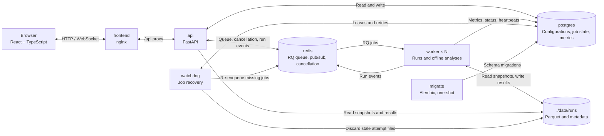
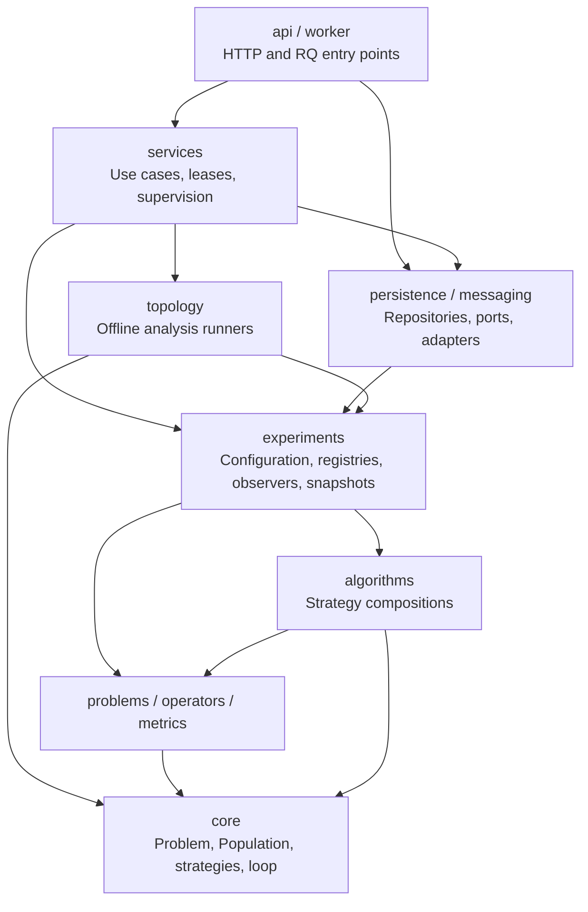
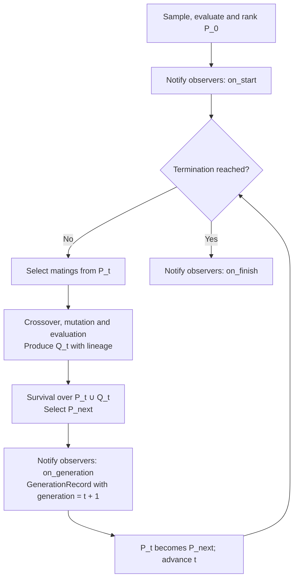
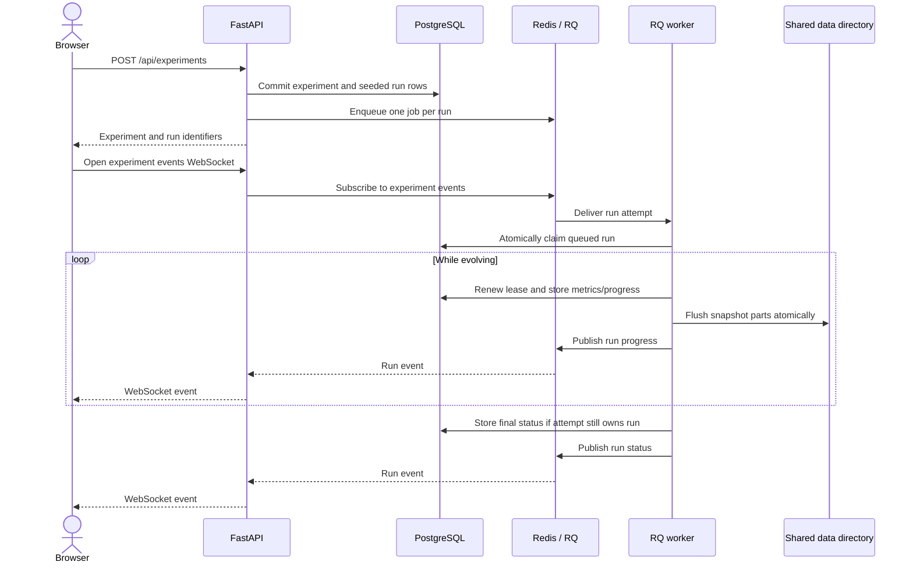
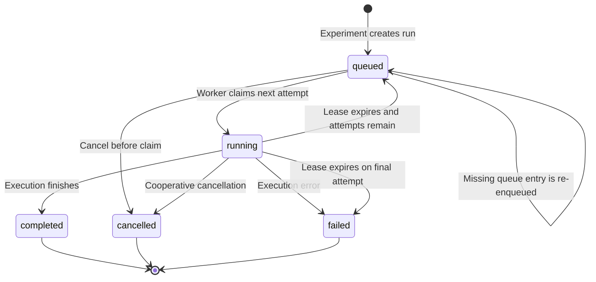
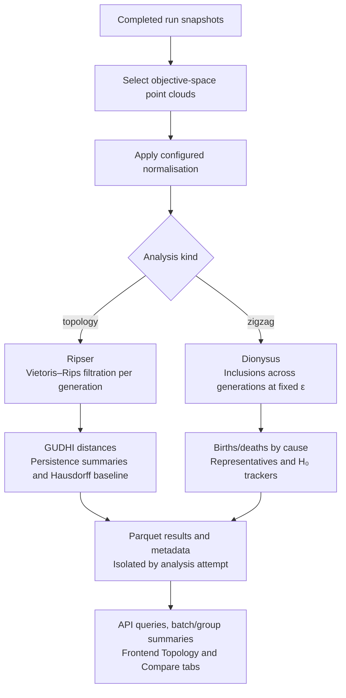
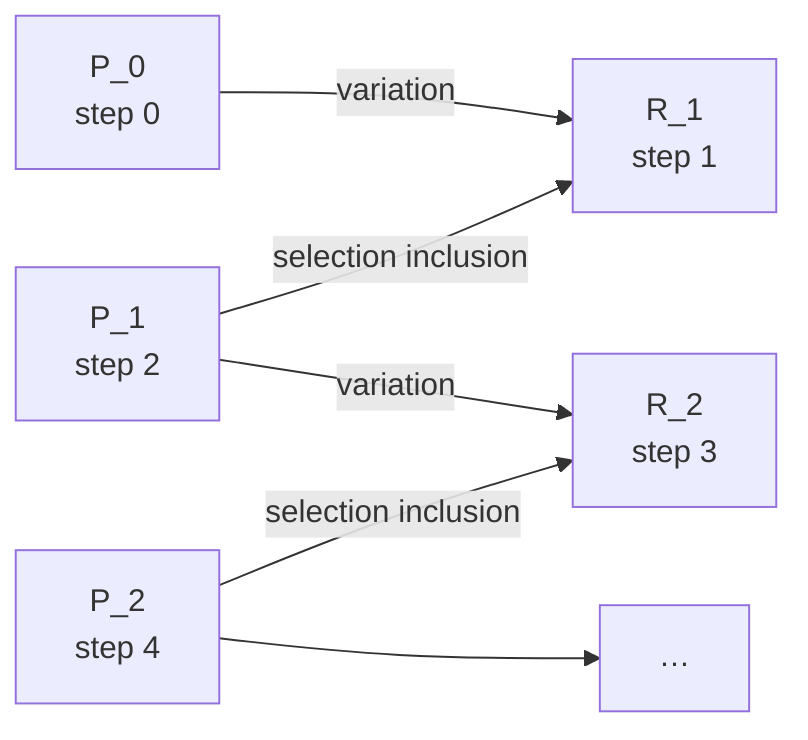

# Architecture

This document describes the implemented platform, its execution and storage contracts, and how
to extend it. For installation and the research motivation, see the [main README](../README.md).

- [Overview](#overview)
- [Backend layers](#backend-layers)
- [Execution, progress and cancellation](#execution-progress-and-cancellation)
- [Recovery of lost workers](#recovery-of-lost-workers)
- [Persistent-homology analyses](#persistent-homology-analyses)
- [Frontend](#frontend)
- [Extending](#extending)
- [Supply-chain policy](#supply-chain-policy)

## Overview

The [Compose configuration](../docker-compose.yml) runs a static frontend, an HTTP API and a
shared pool of RQ workers. PostgreSQL owns durable job state; Redis carries queue entries,
live events and cancellation flags. Snapshots and analysis results live on the shared data mount.



| Service    | Responsibility                                                                                       |
| ---------- | ---------------------------------------------------------------------------------------------------- |
| `frontend` | Static React build served by nginx, which also proxies `/api` to the API.                            |
| `api`      | Validates configurations, manages experiments, serves results and live events.                       |
| `worker`   | Executes one RQ job per run or analysis attempt; scale with `docker compose up -d --scale worker=N`. |
| `watchdog` | Recovers runs and analyses with expired leases or missing queue entries.                             |
| `migrate`  | One-shot Alembic migration before the API and workers start.                                         |
| `postgres` | Experiment and analysis configurations, job state, batches and per-generation run metrics.           |
| `redis`    | Job queue (RQ), run events (pub/sub) and cooperative cancellation flags.                             |

Backend containers start as root only long enough to adopt the owner of the mounted `./data`
directory, then drop privileges to that user (`backend/docker-entrypoint.sh`). Files written by
the workers therefore belong to the host user with no configuration.

`migrate` must finish successfully before `api`, `worker` and `watchdog` start. PostgreSQL data
is stored in the `pgdata` volume. Redis persistence is disabled in Compose, so the watchdog
reconstructs missing queue entries from PostgreSQL after a Redis restart. Live pub/sub events
are transient; durable state and results are read through the API.

## Backend layers

The backend lives in [`backend/src/esphea/`](../backend/src/esphea/). The numerical domain has
no HTTP, database or queue dependencies. Services coordinate execution and storage; delivery
modules wire them to infrastructure. Arrows below show the main dependency directions, grouping
related packages rather than listing every import.



| Package         | Responsibility                                                                                     |
| --------------- | -------------------------------------------------------------------------------------------------- |
| `core`          | Problem and population contracts, operator interfaces, records, termination and generational loop. |
| `problems`      | DTLZ2, DTLZ2-H, DTLZ7, ZDT1, ZDT3 and ZDT4 benchmarks.                                             |
| `operators`     | Sampling, mating selection, SBX, polynomial mutation and survival strategies.                      |
| `algorithms`    | NSGA-II, NSGA-III and generational SMS-EMOA assembled from strategies.                             |
| `metrics`       | Quality indicators and classical diversity metrics.                                                |
| `experiments`   | Validated configurations, registries, observers, snapshot storage and run executor.                |
| `topology`      | Point clouds, persistence, diagram distances, zigzag, niche trackers and result storage.           |
| `persistence`   | SQLAlchemy models and repositories.                                                                |
| `messaging`     | Protocols for jobs, events and cancellation, plus Redis/RQ adapters.                               |
| `services`      | Experiment and analysis use cases, result queries, leases, recovery and process supervision.       |
| `api`, `worker` | HTTP/WebSocket endpoints, dependency wiring, RQ tasks and watchdog entry point.                    |

### The evolutionary loop

`core.EvolutionaryAlgorithm` implements one elitist generational loop:



Here `P_next = P_{t+1}` and `Q_t` is produced from `P_t`. Generation 0 contains the initial
population only; record `g ≥ 1` describes `P_{g-1}`, `Q_{g-1}` and the survivors `P_g`.
This indexing is also used in snapshots and in the zigzag sequence below.

NSGA-II, NSGA-III and SMS-EMOA are the same loop with different strategies:

|                  | NSGA-II                                   | NSGA-III                                                                                    | SMS-EMOA                                                                      |
| ---------------- | ----------------------------------------- | ------------------------------------------------------------------------------------------- | ----------------------------------------------------------------------------- |
| Mating selection | binary tournament (rank, crowding)        | random                                                                                      | random                                                                        |
| Crossover        | SBX, η = 15, p = 0.9                      | SBX, η = 30, p = 1                                                                          | SBX, η = 15, p = 0.9                                                          |
| Mutation         | polynomial, η = 20, p = 1/n               | polynomial, η = 20, p = 1/n                                                                 | polynomial, η = 20, p = 1/n                                                   |
| Survival         | non-dominated sorting + crowding distance | non-dominated sorting + reference-point niching                                             | non-dominated sorting + least hypervolume contribution, removed one at a time |
| Population       | user defined                              | defaults to the smallest multiple of 4 ≥ number of Das–Dennis directions; can be overridden | user defined                                                                  |

SMS-EMOA is originally steady state (one offspring per iteration). Here it produces a whole
generation of offspring and then removes the least contributors of `P_t + Q_t` one by one, so its
generations line up with those of the NSGA variants (and with the zigzag `P_t → R_{t+1} ← P_{t+1}`).

**Why pymoo is used for parts of the loop and not for the whole run.** The study needs the
populations inside each generation (parents, offspring and survivors), which pymoo's
`minimize` does not expose as such. We therefore own the loop and the data it emits, and
delegate the numerically delicate pieces to pymoo through adapters
(`operators/variation.py`, `operators/survival.py`): its vectorised SBX/PM kernels and its
compiled non-dominated sorting, NSGA-III normalisation/niching and SMS-EMOA hypervolume
contributions. Only the adapters import
pymoo. A slow test checks that NSGA-II and NSGA-III are statistically equivalent to pymoo's native
implementations on DTLZ2.

**Populations are structures of arrays** (`X` of shape `(n, n_var)`, `F` of shape `(n, n_obj)`,
plus per-individual attribute arrays such as `rank`). Object orientation lives at the level of
components, while every numerical step stays vectorised. Arrays are read-only, so the same
population can be handed to any number of observers safely.

### Observers: where analyses plug in

Run-time instrumentation implements `AlgorithmObserver`, with `on_start`, `on_generation`
and `on_finish` hooks:

- `IndicatorObserver` computes IGD, IGD+, GD and hypervolume on the first front of the
  survivors, and the hypervolume of the offspring `Q_t` that produced the generation
  (`hv_offspring`, from generation 1 on, same reference point); it also computes the
  diversity metrics (`spacing` and `spread` on the first front, `mean_distance` on the
  survivors, all with objectives scaled by the ideal and nadir points, and
  `decision_inertia` on the variables scaled by the bounds), storing a value only where it is
  defined (e.g. at least two points);
- `SnapshotObserver` writes generation snapshots to Parquet;
- `ProgressObserver` streams progress and the current front.

Persistent homology and zigzag are already implemented as **offline analyses** over snapshots,
so changing their parameters does not require another evolutionary run. Observers remain the
extension point for computations that need to happen during evolution.

### Generation snapshots

Each execution attempt of a run has a directory `data/runs/<run-id>/attempt-<n>/` with
`meta.json` and `part-*.parquet` files (normally only `attempt-1`; see
[recovery](#recovery-of-lost-workers)). At generation `g ≥ 1`, there is one row per candidate
in `P_{g-1} ∪ Q_{g-1}`; at generation 0 there is one row per individual in `P_0`.
Selecting rows with `survived = true` reconstructs `P_g`.

| column                 | meaning                                                                |
| ---------------------- | ---------------------------------------------------------------------- |
| `generation`           | `g` (0 = initial population, otherwise the generation being produced)  |
| `individual_id`        | run-unique identity of the individual (schema 2)                       |
| `role`                 | 0 = parent pool `P_{g-1}` (or `P_0` at g = 0), 1 = offspring `Q_{g-1}` |
| `index`                | position within its role                                               |
| `survived`             | selected into `P_g` (all true at generation 0)                         |
| `rank`                 | non-domination rank in the survival (-1 if discarded)                  |
| `times_selected`       | number of matings the parent took part in                              |
| `parent_a`, `parent_b` | indices into `P_{g-1}` (offspring rows; -1 otherwise)                  |
| `mutated`              | whether mutation changed the offspring                                 |
| `x_0 … x_{n-1}`        | decision variables (optional)                                          |
| `f_0 … f_{m-1}`        | objectives                                                             |

Rows are buffered and flushed as zstd-compressed parts every few generations, so memory stays
bounded, and parts are renamed atomically so they can be read while the run is still going.
Storage is controlled per experiment (every N-th generation, `float32`, objectives only). For
example, NSGA-III on 3-objective DTLZ2 with 92 individuals, 250 generations, all variables in
`float64` takes about 3 MB per run on disk.

Reading a run in a notebook:

```python
from pathlib import Path

import pyarrow.dataset as ds

attempt = Path("data/runs/<run-id>/attempt-1")
parts = sorted(str(path) for path in attempt.glob("part-*.parquet"))
table = ds.dataset(parts, format="parquet").to_table()
df = table.to_pandas()          # or polars.from_arrow(table)
gen = df[df.generation == 100]
survivors = gen[gen.survived]    # P_100; gen also includes discarded candidates
```

Selecting only `part-*.parquet` excludes `meta.json` from the Arrow dataset. Use the current
attempt number reported by the API when reading a run that has been retried.

## Execution, progress and cancellation



1. `POST /api/experiments` stores the experiment and one row per run (seeds derived with
   `numpy.random.SeedSequence`), then enqueues one RQ job per run.
2. A worker claims the run atomically (`queued → running`) and executes it. Metric rows are
   written in batches; progress (generation and current first front) is published on Redis at
   most once every 250 ms and forwarded by the API to the browser over a WebSocket.
3. Cancellation is cooperative: the API sets a Redis flag, checked between generations with
   Redis reads throttled to at most one every 500 ms. A long generation can delay the stop;
   once cancellation is observed, the run stops cleanly and keeps its stored results.

## Recovery of lost workers

A worker that dies in the middle of a run (crash, OOM, container killed) cannot report it, so
ownership of a run is a **lease** held by an **attempt**:



- Claiming a queued run starts attempt _n_ (`attempt` column) and sets `heartbeat_at`. A thread
  in the worker renews the heartbeat every 5 s, independently of how long a generation takes.
- The `watchdog` service sweeps every 10 s. A running run whose heartbeat is older than 60 s
  lost its worker: its partial metrics and snapshots are discarded and it is queued again as
  attempt _n + 1_ (seeds are fixed, so the retry is reproducible). After 3 attempts the run is
  marked failed. A queued run whose job is missing from Redis (e.g. after a Redis restart) is
  simply enqueued again.
- **Fencing:** every write of a worker (metrics, progress, final status) only applies while the
  run is still owned by its attempt, and snapshots go to a per-attempt directory. A worker that
  was merely cut off also stops by itself after 30 s without a successful heartbeat, before the
  watchdog can hand the run over. A late or "zombie" worker therefore can never corrupt the retry.

Timings are configurable (`ESPHEA_HEARTBEAT_INTERVAL_SECONDS`, `ESPHEA_LEASE_TIMEOUT_SECONDS`,
`ESPHEA_MAX_RUN_ATTEMPTS`, `ESPHEA_WATCHDOG_INTERVAL_SECONDS`, `ESPHEA_ENQUEUE_GRACE_SECONDS`).
Missing queue entries are checked after the enqueue grace period (120 s by default). Pass
setting overrides into the backend containers' `environment` in Compose. Analyses use the same
lease and recovery mechanism; the diagram above shows the run lifecycle, including cancellation.

## Persistent-homology analyses

Analyses are computed **offline** from the stored generations of a finished run, so the same run
can be analysed with different parameters without re-running the algorithm. They are leased jobs
like runs (same queue, heartbeats, fencing and watchdog recovery).



The following per-generation pipeline describes `kind: topology`; `kind: zigzag` uses the
cross-generation construction in the next section.

For every stored generation `g` an analysis computes:

1. the **point cloud** in objective space: the survivors `P_g` (default), the candidates
   `P_{g-1} ∪ Q_{g-1}` or the first front of `P_g`;
2. an optional **normalisation**: none (default), fixed (ideal → 0, nadir → 1, the same map for
   every generation) or min–max per generation (shape without scale);
3. the **Vietoris–Rips** persistence diagram (Ripser) of `H_0 … H_k` (k ≤ 2), with ε the
   maximum _edge length_, from 0 to the configurable `max_epsilon`. Features still alive at
   `max_epsilon` (always including the essential class of `H_0`) are truncated there, which keeps
   all distances finite; diagrams are only comparable for the same `max_epsilon`;
4. **distances between diagrams** (GUDHI: exact bottleneck and Wasserstein W₁ with the L∞ ground
   metric), per dimension, to the previous stored generation and to the final one, plus the
   **Hausdorff distance** between the clouds as the baseline of the stability theorem
   (`d_B(D(X), D(Y)) ≤ 2·d_H(X, Y)`);
5. summaries (number of bars, total persistence, persistent entropy) and, on request, the
   pairwise distance matrix of up to 100 generations.

Results live in `data/runs/<run-id>/analyses/<analysis-id>/attempt-<n>/` (`diagrams.parquet`,
`series.parquet`, `clouds.parquet`, optional `matrix.parquet`, `meta.json`). Betti curves are
derived from the diagrams on request. `GET /api/runs/{id}/epsilon-suggestion` reports the cloud
diameters and nearest-neighbour spacing of the run to help choosing `max_epsilon` (the suggested
value is the largest diameter, so every finite feature is captured).

Note on `H_0`: populations may contain identical individuals (clones), which merge at ε = 0;
β₀(0) therefore counts _distinct_ points.

### Zigzag persistence across generations

A zigzag analysis follows the topology of the population _through_ the evolution, along the
sequence of inclusions



For `rips`, `R_t = P_{t-1} ∪ Q_{t-1}`: it is the candidate set that produces `P_t`.
For `union`, `R_t = P_{t-1} ∪ P_t`. Arrows denote **set inclusions**: selection proceeds from
`R_t` to `P_t` in time, but its inclusion arrow points from `P_t` back into `R_t`.

Steps are numbered with `P_t` at step `2t` and `R_t` at step `2t − 1`. Every set is replaced by its
Vietoris–Rips complex at a **fixed scale ε** (up to five scales per analysis, H₀ … H₂).
Individuals keep their identity along the sequence (the `individual_id` of the snapshots, so
runs stored before schema 2 cannot be zigzagged, and every generation must be stored).
Normalisation must be `none` or the fixed `ideal_nadir` map; per-generation `min_max` scaling
would break the inclusions and is rejected for zigzag analyses.

**Complex at `R_t`.** `rips` (default) takes the Vietoris–Rips complex of every candidate;
`union` takes VR(P_{t-1} ∪ P_t), the subcomplex induced by the parents and the survivors, and
leaves out the offspring discarded at once (not even their vertices). The first zigzag records
what each generation builds and destroys, including the niches joined and the holes opened or
filled for a single step by candidates that selection rejects; the union zigzag
`P_{t-1} → P_{t-1} ∪ P_t ← P_t` follows the features of the populations themselves, since a class of
`P_{t-1}` and one of `P_t` are the same feature exactly when their images in VR(P_{t-1} ∪ P_t)
agree, whoever carries them. VR(P_{t-1}) ∪ VR(P_t) would not do: it lacks the edges from a
discarded parent to the offspring that replaces it, and a loop handed over between them would
split. The niche trackers see the same sets as the zigzag they are compared with. `bridge` and
`bridge_union` (a base joined by a spanning forest, with the H₀ of `rips`) are retired: analyses
stored with them still load, and new ones are rejected.

A bar is alive on steps `[birth, death − 1]`. Forward arrows only insert simplices (offspring)
and backward arrows only remove them (discarded individuals), so every event has a cause:

| event | on a forward arrow `P_{t-1} → R_t`              | on a backward arrow `R_t ← P_t`                      |
| ----- | ----------------------------------------------- | ---------------------------------------------------- |
| birth | **variation**: e.g. offspring found a new niche | **selection**: e.g. removing a bridge splits a niche |
| death | **variation**: e.g. offspring bridge two niches | **selection**: e.g. a niche is wiped out             |

The barcode is computed with Dionysus' fast zigzag (Dey and Hou), which reduces the zigzag to
the extended persistence of a cone. Tests check, on random sequences, that the number of bars
alive at every step equals the Betti numbers computed independently by Ripser, and the API
reports identities such as `β(R_t) = β(P_{t-1}) + births_var(t) − deaths_var(t)`.

**Representatives.** For the longest bars, the representative cycle at each step is stored
(as individual ids); for H₀ the API expands it to the ε-connected niche. Keeping the matrix
needed for representatives is far more expensive than the barcode (0.8 M simplices: ~60 s and
2.4 GB, against ~5 s), so representatives are only extracted up to 500 000 simplices per scale;
above that the scale records why they were skipped. Representatives of intervals of type
"open at birth, closed at death" are sometimes unavailable (a Dionysus limitation) and are
reported as such.

**Cost and memory.** Each scale is limited to 3 M simplices (about 1–2 GB). Suggested scales are
1, 1.5 and 2 × the median nearest-neighbour spacing of the _population_ `P_t` (the spacing of
`R_t` is dominated by offspring next to their parents and would isolate every individual).

**Batches.** The same analysis can be queued for every finished run of an experiment; the batch
summary gives the median and quartiles across runs of the Betti numbers and of births and deaths
by cause, per generation, and the batch persistence diagram pools the bars of every run, counted
per (birth, death) step (runs of different lengths are cut to the shortest).

**Niche trackers.** At every scale the zigzag analysis also follows the H₀ niches with three
heuristic trackers (`esphea.topology.trackers`), stored as `trackers.parquet` (zigzag results
schema 2). They see the same niches as the zigzag and differ only in how they link them over
time:

| tracker | sees                       | rule                                                                              |
| ------- | -------------------------- | --------------------------------------------------------------------------------- |
| `t1`    | every `P_t` and `R_t`      | elder rule at merges, largest fragment keeps the bar at splits (tracking graphs)  |
| `t1o`   | every `P_t` and `R_t`      | as `t1`, but the fragment holding the oldest individual keeps the bar             |
| `t2`    | the populations `P_t` only | components matched through shared survivors, as cluster and community trackers do |

The comparison reports, per method, the number of bars, the long bars (alive at least
`long_lifetime` steps), lifetime quantiles and the share of the zigzag bars a tracker reproduces,
matched by step or by generation. Matching by generation counts `R_t` and `P_t` as generation `t`,
which removes the one-step offset of `t2`: it never sees `R_t`, so it dates births by offspring and
merges through offspring at `P_t`. Endpoints: `GET /api/analyses/{id}/zigzag/trackers/{method}/bars`,
`.../zigzag/trackers/comparison`, `GET /api/analysis-batches/{id}/tracker-comparison` and
`GET /api/experiments/{id}/analysis-groups/{key}/tracker-comparison` (per-run values). Results
written before the trackers existed answer 404 and are skipped in batches and groups; running the
analysis again computes them.

**Groups and comparison.** `GET /api/experiments/{id}/analysis-groups` groups an experiment's
analyses (either kind) by configuration, keeping the newest completed analysis of each run.
Settings that only change what is stored (`distance_matrix`, `representatives`) are left out of
the group key, which is a hash of the configuration alone: the same configuration has the same
key in every experiment. `GET .../analysis-groups/{key}/summary` gives, per generation, the
median and quartiles across runs of every summarised series (barcode summaries and distances, or
zigzag Betti numbers and events), plus the spread of the per-run totals of the zigzag events.
The _Compare_ page uses them to set experiments side by side: it picks by default the
configuration shared by most selected experiments, warns when the compared analyses differ in
normalisation, point cloud or scale, and can queue the same configuration for the experiments
that lack it. Summaries are only comparable within one scale and one objective space, so a fixed
normalisation (`ideal_nadir`) and equal ε are the meaningful setting across experiments.

Analyses run in a **supervised child process** (`spawn`): native code such as Dionysus holds
the GIL for long stretches, so the parent process keeps the lease heartbeat alive, relays
progress and terminates the child if the lease is lost.

## Frontend

React + TypeScript (strict) + Vite, with Mantine for components, TanStack Query for server
state and Plotly for scientific charts (loaded lazily).

- API types are generated from the backend's OpenAPI document (`make openapi`), so the
  contract is checked at compile time.
- Configuration is validated by the server: the editor sends every change (debounced) to
  `POST /api/experiments/preview`, which returns derived quantities or field-level errors.
- Chart colours come from a palette validated for colour-vision deficiency in both themes.
  Identity is never colour alone (filled = survived, open = discarded; legends everywhere).

## Extending

**A new problem.** Subclass `core.Problem` (vectorised `_evaluate`), and implement
`KnownParetoFront` if the front is known (enables IGD/IGD+/GD/HV). Add a config model in
`experiments/config.py` to the `ProblemConfig` discriminated union (on `name`), register a
builder in `experiments/registry.py` and list its defaults in the API catalog. The ZDT
problems (`problems/zdt.py`) show the pattern for a family: a base class holds the shared
structure `f_2 = g * h` and extracts the front numerically, so each member only defines `g`
and `h`.

**A new algorithm.** Compose `core.EvolutionaryAlgorithm` with existing or new strategies
(`MatingSelection`, `Crossover`, `Mutation`, `Survival`). Add its config model to the
`AlgorithmConfig` union and register a builder.

**A new analysis per generation.** Implement an `AlgorithmObserver` and add it in
`experiments/runner.py`. It receives every `GenerationRecord`.

**A new offline analysis.** Add a validated configuration to `topology/config.py`, implement
`AnalysisRunner` in `topology/runners.py` and register it in `default_runners()`. Add its result
storage and API queries following the existing topology or zigzag analyses. This route reuses
stored snapshots, supervised execution, leases and watchdog recovery.

After changing API models, run `make openapi` to regenerate the frontend types.

## Supply-chain policy

- Python dependencies are resolved by `uv` with `exclude-newer` (no release younger than the
  cut-off date) and locked with hashes (`backend/uv.lock`).
- npm dependencies were resolved with `npm install --before=<date>` and are installed with
  `npm ci` from the lockfile (`frontend/package-lock.json`, integrity hashes).
- Package names, maintainers and source repositories are verified on PyPI/npm before adding a
  dependency.
- Docker base images and GitHub Actions are pinned by digest/commit SHA.
